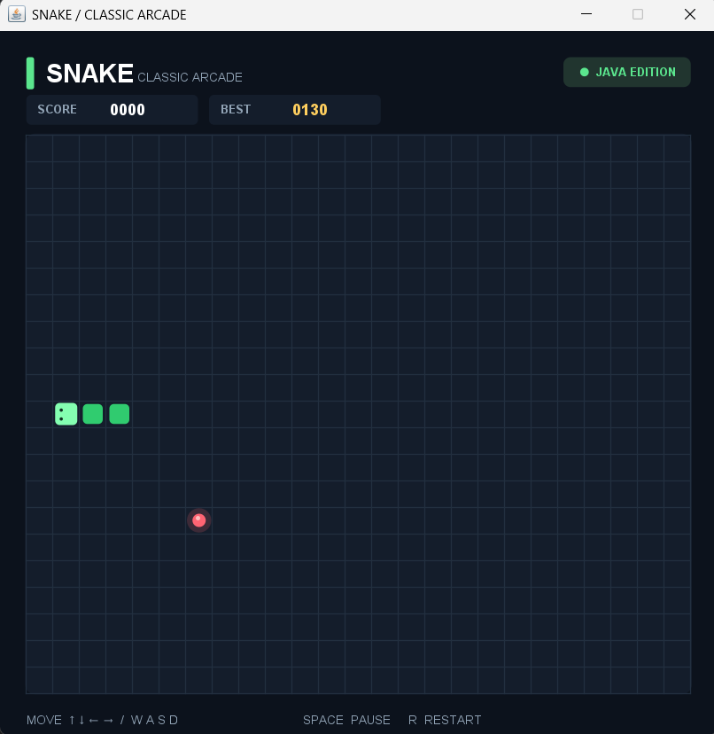
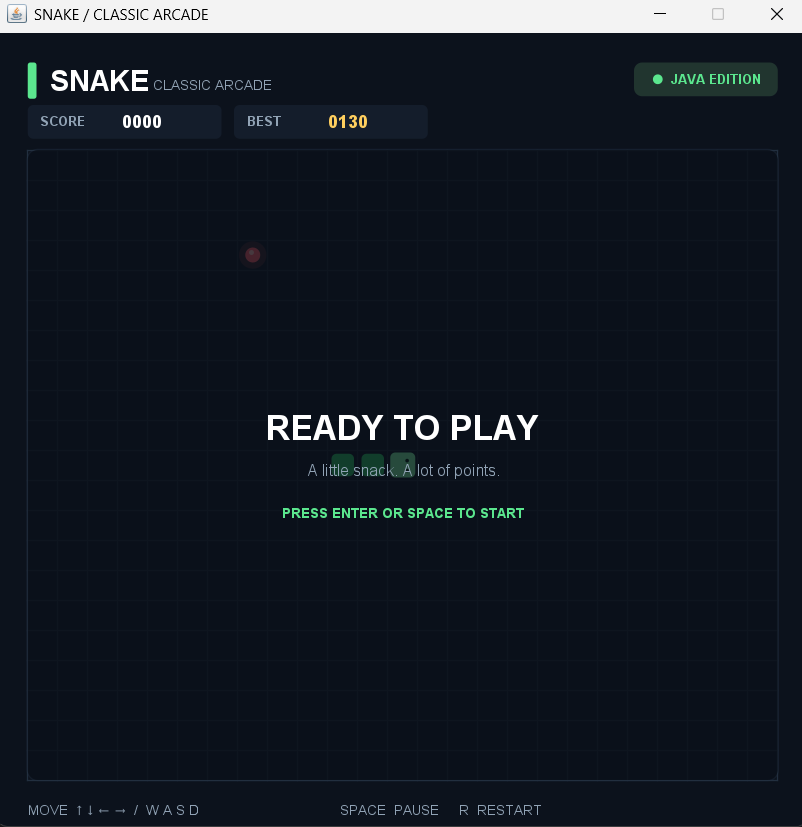
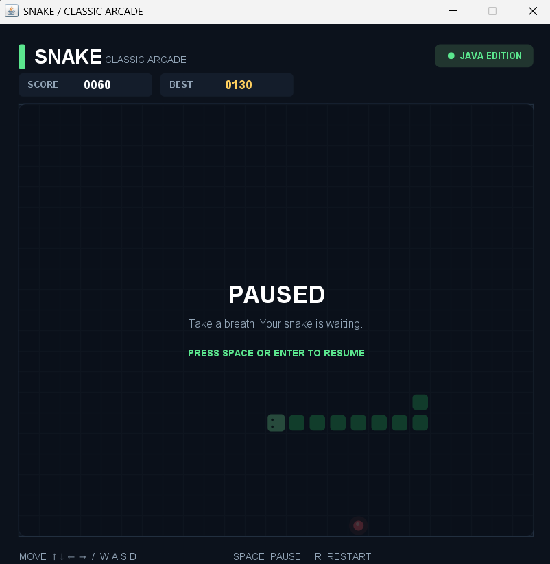
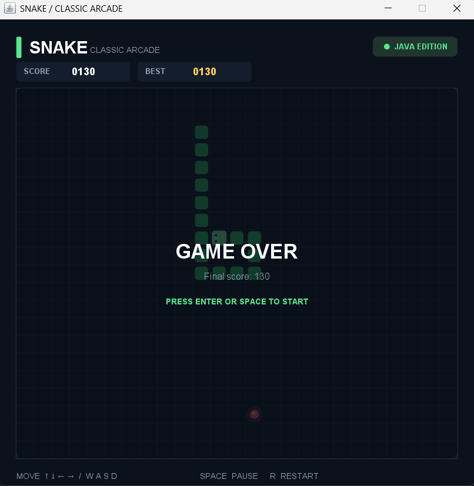
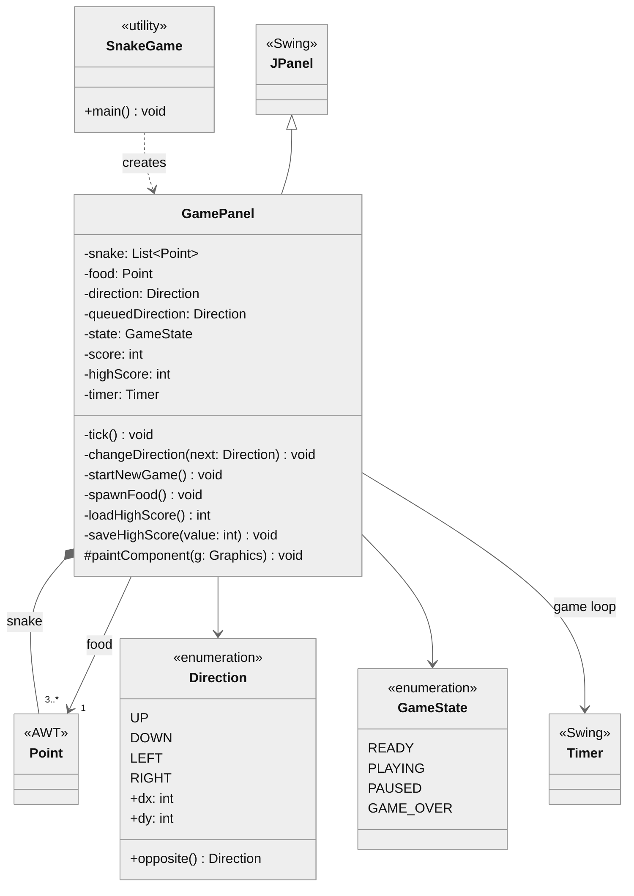
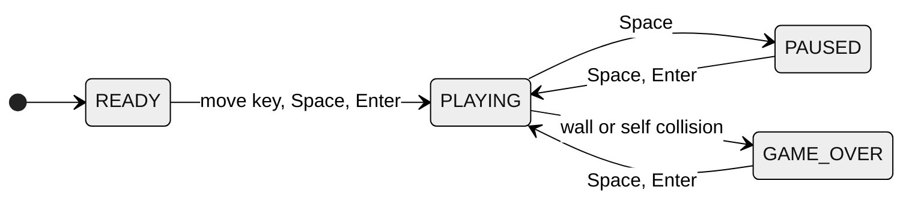
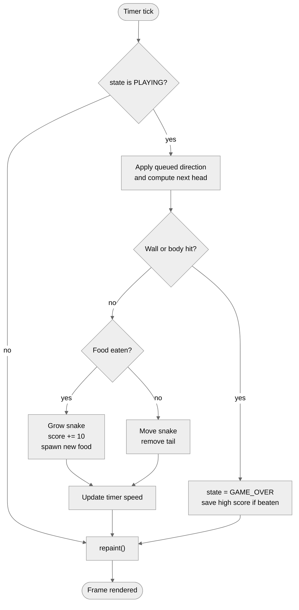

# 🐍 Snake — Classic Arcade Game


A self-contained implementation of the classic Snake game written in **Pure Java and Swing**. 
No external libraries, no build tools, one source file. 
It features a dark arcade-style UI, smooth keyboard controls, progressive speed-up, pause/restart support, and a high score that is saved between sessions.

- This was originally my College Project for Advanced Java Programming and I modified it a little bit (UI), but the Idea was simple so it remains the same. 


---

## 📸 Screenshots

<table>
  <tr>
    <td align="center"><b>Gameplay</b></td>
    <td align="center"><b>Ready screen</b></td>
  </tr>
  <tr>
    <td></td>
    <td></td>
  </tr>
  <tr>
    <td align="center"><b>Paused</b></td>
    <td align="center"><b>Game over</b></td>
  </tr>
  <tr>
    <td></td>
    <td></td>
  </tr>
</table>

---

## ✨ Features

- **Classic gameplay**: eat food, grow longer, avoid the walls and your own tail.
- **Progressive difficulty**: the game speeds up as your score increases.
- **Persistent high score**: your best score is stored on disk and shown in the **BEST** box.
- **Pause / resume / restart** at any time.
- **Responsive input**: arrow keys *and* WASD, with input queuing so you can never reverse straight into yourself.
- **Polished UI**: anti-aliased rendering, rounded segments, a glowing food item, directional eyes on the snake's head, and overlay screens for *Ready*, *Paused* and *Game Over*.
- **Zero dependencies**: only `javax.swing`, `java.awt`, `java.io` and `java.nio` from the JDK.

---

## 🚀 Getting Started

### Prerequisites

- **JDK 14 or newer** (JDK 17+ recommended). The code uses switch expressions (Java 14+) and `Files.readString` / `Files.writeString` (Java 11+).

Check your version:

```bash
java -version
```

### Run it

```bash
# Clone the repository 
git clone https://github.com/rishabh-stacks/java-snake-game-gui.git
cd java-snake-game-gui

# Compile
javac SnakeGame.java

# Run
java SnakeGame
```

Or run directly from source without a separate compile step:

```bash
java SnakeGame.java
```

> The class `SnakeGame` is `public final`, so the file must be named `SnakeGame.java`.

---

## 🎮 Controls

| Key | Action |
|-----|--------|
| `↑` `↓` `←` `→` or `W` `A` `S` `D` | Move the snake (the first direction key also starts the game from the *Ready* screen) |
| `SPACE` | Start (from *Ready* / *Game Over*), pause, or resume |
| `ENTER` | Start (from *Ready* / *Game Over*) or resume (from *Paused*) |
| `R` | Restart immediately from any state |

---

## 📋 Game Rules & Scoring

- The board is a **25 × 21** grid of 24 px cells (600 × 504 px).
- The snake starts with **3 segments** in the centre of the board, heading right.
- Each piece of food is worth **10 points** and grows the snake by one segment.
- Food always spawns on a random cell that is **not** occupied by the snake.
- The game ends if the head touches a **wall** or **any part of the body**.
- Moving into the cell the tail is just leaving is allowed, so tight turns behave the way players expect.

### Speed progression

The timer delay (time between moves) shrinks by 2 ms for every 10 points:

```
delay = max(58, 115 - (score / 10) * 2)   // milliseconds
```

| Score | Delay between moves |
|------:|--------------------:|
| 0     | 115 ms |
| 100   | 95 ms |
| 200   | 75 ms |
| 290+  | 58 ms (maximum speed) |

### High score storage

The best score is saved as plain text in your home directory:

```
~/.snake-game-highscore
```

Delete that file to reset the high score.

---

## 🧩 UML Diagrams

Three diagrams describe the design from different angles. They are written in [Mermaid](https://mermaid.js.org/) and render automatically on GitHub. Yes, I know Mermaid and Use Obsidian (Don't Judge Me)

### 1. Class Diagram

`GamePanel`, `GameState` and `Direction` are nested types of `SnakeGame`. Swing/AWT types are shown only where they take part in a relationship.



### 2. State Diagram

The game is always in exactly one of four states. Pressing `R` restarts the round from any state and returns to `PLAYING`.



### 3. Activity Diagram

The complete logic of a single call to `tick()`.



---

## 🏗️ How It Works

| Concern | Implementation |
|---------|----------------|
| **Game loop** | A `javax.swing.Timer` calls `tick()` on the Event Dispatch Thread, so no extra threading or locking is needed. |
| **Snake body** | A `List<Point>` where index `0` is the head. Moving = insert a new head and (unless eating) remove the tail. |
| **Input** | Swing key bindings (`InputMap` / `ActionMap`) with `WHEN_IN_FOCUSED_WINDOW`, so keys work without clicking the panel. |
| **Input queuing** | `queuedDirection` plus the `movedThisTick` flag allow only one valid turn per tick and block 180° reversals. |
| **Collision** | Wall bounds check plus `snake.subList(0, limit).contains(next)`. When not eating, the tail cell is excluded because it will vacate on this move. |
| **Persistence** | `Files.readString` / `Files.writeString` on `~/.snake-game-highscore`. Failures are ignored so the game still runs on read-only systems. |
| **Rendering** | Custom painting in `paintComponent` using `Graphics2D` with anti-aliasing. All drawing is split into small `draw*` helpers. |

---

## ⚙️ Customisation

Most of the game's feel can be tuned by editing a few values in `SnakeGame.java`:

| What | Where | Default |
|------|-------|---------|
| Cell size (px) | `CELL` in `GamePanel` | `24` |
| Board width (columns) | `COLS` | `25` |
| Board height (rows) | `ROWS` | `21` |
| Starting speed (ms per move) | `new javax.swing.Timer(115, ...)` | `115` |
| Maximum speed (ms per move) | `Math.max(58, ...)` in `tick()` | `58` |
| Points per food | `score += 10` in `tick()` | `10` |
| Colour theme | `BG`, `PANEL`, `GREEN`, `MUTED` | dark navy and green |

---

## 📁 Project Structure

```
.
├── SnakeGame.java        # The entire game (logic + rendering)
├── README.md
└── screenshots/
    ├── gameplay.png
    ├── ready.png
    ├── paused.png
    └── game-over.png
```

---

## 🤝 Contributing

Issues and pull requests are welcome. If you add a feature (obstacles, levels, sound, wrap-around walls), please keep the project dependency-free so it stays easy to compile with a single `javac` command.
